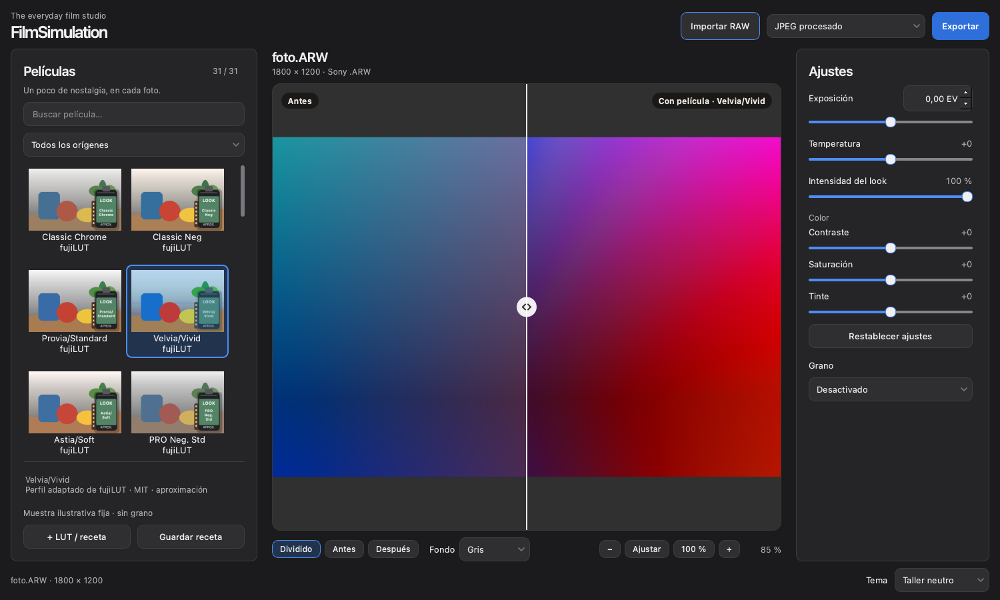
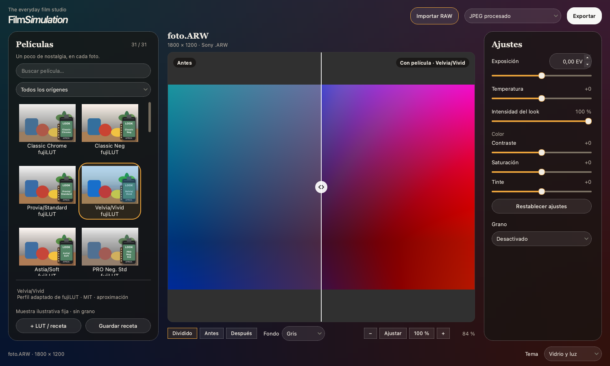

# FilmSimulation

[](https://github.com/sebastianriquelme1321/FilmSimulation/releases/latest)
[](LICENSE)
[](https://github.com/sebastianriquelme1321/FilmSimulation/actions/workflows/tests.yml)

**English** · [Español](README.es.md)

A free, open-source desktop app to develop RAW photos, edit ordinary photos (JPEG, PNG, TIFF) and apply film simulations. **Everything runs on your machine: no accounts, no cloud, no telemetry.** It ships 31 looks, a viewer with zoom and a before/after divider, adjustments for exposure, color and grain, shareable recipes, your own LUTs, and full-resolution JPEG export. Film names only describe the look being approximated; these are not official profiles.

> **Beta.** Verified with real Sony ARW files. Other RAW formats are supported through LibRaw but untested (see [Known limitations](#known-limitations)). Feedback is very welcome.





(Screenshots use a synthetic photo; they do not include real photographs.)

## Download

Get the latest beta from [**Releases**](https://github.com/sebastianriquelme1321/FilmSimulation/releases/latest):

| System | File |
| --- | --- |
| macOS, Apple Silicon (M1 or later) | `FilmSimulation-macos-arm64.zip` |
| macOS, Intel | `FilmSimulation-macos-x86_64.zip` |
| Windows 64-bit | `FilmSimulation-windows-x64.zip` |

**The apps are not code-signed.** On macOS: unzip, drag `FilmSimulation.app` to *Applications*, and the first time right-click it → **Open** → **Open** (if it is still blocked: `xattr -dr com.apple.quarantine /Applications/FilmSimulation.app`). On Windows: run `FilmSimulation.exe`; if SmartScreen appears, choose **More info → Run anyway**.

The Windows build compiles and passes the automated tests, but it has not been tried by hand yet. If you try it, please tell me how it went.

## Features

- Three columns: films (looks) on the left, the viewer in the center, adjustments on the right.
- Import a photo (RAW, JPEG, PNG or TIFF) with the **Importar foto** button or by dragging it onto the window.
- Viewer with zoom, pan and a draggable before/after divider.
- Adjustments before the look: exposure, temperature, contrast, saturation and tint; look strength and grain.
- Local library of `.cube` LUTs, HaldCLUTs and JSON recipes.
- Export a processed JPEG (EXIF is kept when the source has it), or a ZIP with the untouched original file plus your settings.
- Two themes: **Taller neutro** (neutral workshop, the default) and **Vidrio y luz** (glass and light).
- LibRaw-based RAW decoding for many brands (Sony ARW verified, the rest experimental) and Pillow-based decoding of JPEG, PNG and TIFF photos, with pluggable decoders.

> The interface is currently in Spanish.

## Usage

1. Import a photo: a RAW, or an ordinary JPEG/PNG/TIFF (the **Importar foto** button, or drag and drop a file onto the window).
2. Pick a film in the left column: click a card or press Enter. Moving through the list with the arrow keys does not apply it.
3. Adjust exposure, temperature, contrast, saturation, tint, strength and grain on the right. **Restablecer ajustes** (reset) returns everything to neutral, keeping the film and the grain.
4. Export with the format selector and the **Exportar** button. The dialog suggests the folder of your last export (or, the first time, the photo's folder) and you can pick another; your choice is remembered.

**Viewer.** The **Dividido**, **Antes** and **Después** buttons switch between the divider, the base only and the film look only. The **Fondo** selector changes the neutral color around the photo (Gris, Negro, Blanco) and is remembered between sessions.

| Action | Gesture or key |
| --- | --- |
| Zoom in / out | Mouse wheel or trackpad scroll (around the cursor); `+` / `-` keys |
| Pan | Drag while zoomed in |
| Move the divider | Drag the white line; ←/→ arrows (2 % per press) in split mode |
| Fit to window | `0` key or the **Ajustar** button |
| 100 % size | `1` key or the **100 %** button |
| Toggle fit / 100 % | Double-click the photo |
| Export | `Cmd+E` (macOS) / `Ctrl+E` (Windows) or the **Exportar** button |

The viewer needs focus (click it) to receive key presses. In the exposure control the arrow keys change 0.1 EV and PageUp/PageDown 0.5 EV; you can also type an exact value.

**Important:** the viewer works on a preview of up to 1280 px on the long side, so “100 %” refers to that preview, not to the photo's pixels. Export does use the full resolution.

## Local library

“Add LUT or recipe” accepts 3D `.cube` LUTs (2–65 points per axis), HaldCLUT PNGs and version-1 JSON recipes. LUTs must expect sRGB input; Log spaces are not detected or converted. Imported code is never executed. “Save recipe” stores a combination of look, adjustments, strength and grain; in-camera JPEG recipes are not directly compatible.

### Recipe format (version 1)

JSON with these keys (any other key is rejected). Required: `version` (always `1`), `name` and `base_look` (the internal name of an installed look, e.g. `Velvia/Vivid (aproximación)`, which cannot be another recipe). Optional: `author`, `source`, `license` (text, up to 500 characters), `input_space` (only `"sRGB"`), `strength` (look strength, 0–1; default 1), `grain` (one of the values of the grain selector; default `"Desactivado"`), `exposure_ev` (−3 to 3), `temperature` (−100 to 100), and `contrast`, `saturation` and `tint` (−100 to 100, neutral at 0; if absent they are 0, so older recipes stay valid).

```json
{"version": 1, "name": "My recipe", "base_look": "Velvia/Vivid (aproximación)", "strength": 0.8,
 "grain": "Desactivado", "exposure_ev": 0.3, "temperature": 10,
 "contrast": 15, "saturation": -10, "tint": 0}
```

The library is stored outside the repository: `%LOCALAPPDATA%/FilmPOC` on Windows and `~/Library/Application Support/FilmPOC` on macOS. The reference on the cards is an illustration generated by code. Imported files and users' photos are not part of the project.

## Adjustments and RAW preservation

Exposure (−3 to +3 EV), relative temperature and tint, contrast and saturation (−100 to 100, neutral at 0) are applied in linear RGB before sRGB encoding and before the look. Temperature is a cool/warm correction relative to the camera white balance, not a Kelvin-calibrated sensor setting; tint shifts between green and magenta; contrast works around mid-gray. Strength blends the adjusted base and the simulation in sRGB; grain is applied afterwards. The preview and the export use the same pipeline. These adjustments cannot recover information that the initial development already clipped.

The export selector offers **JPEG procesado** (processed JPEG) or **RAW original + ajustes (.zip)** (for a JPEG/PNG/TIFF source it reads **Original + ajustes (.zip)**). The ZIP keeps the original file (ARW, JPEG...) byte for byte with its original metadata, a JSON recipe, a SHA-256 checksum and the local LUT when applicable. It does not modify the sensor mosaic or bake the look into the original file. To restore: extract the archive, import the original and add `edit.recipe.json` to the library. If it includes `library/`, copy its contents into the local library and restart before importing the recipe. Other editors do not interpret this format automatically. Processed DNG export is not available.

The included profiles and imported LUTs work with sRGB input. There is no automatic conversion from Rec.709, S-Log or other Log curves; a gamma selector alone would not fix primaries, gamut or a LUT's reference exposure.

## Navigation and performance

Searching, changing the origin filter or moving through cards with the arrow keys does not apply a film; click a card or confirm with Enter. The active simulation is kept even if it falls outside the filter; importing a photo with no film selected shows only the adjusted base.

References are prepared in the background. Decoded tables are stored in a disposable local cache inside the library; the first preparation can take longer, and a missing or damaged cache is simply recomputed. Previews use at most 1280 px on the long side and a separate thread with a single pending request: when you move controls quickly, the latest setting wins. The base and the simulation are reused when you change strength or grain. Export keeps the original resolution and the same color pipeline; it does not use the reduced preview pixels.

## Appearance

The **Tema** selector, at the bottom right, switches between **Taller neutro** (default: neutral grays and a single blue accent) and **Vidrio y luz** (translucent panels, amber accent and an ambient background derived from the photo). The preference is stored locally. In both themes the photo viewer uses a neutral backdrop (Gris by default, or Negro/Blanco). Changing the theme does not reprocess or alter the exported image.

## Run from source

Requires 64-bit Python 3.12 or 3.13. On Windows: `py -3.12 launch.py`. On macOS: `python3.12 launch.py`. The launcher creates a virtual environment and installs the dependencies. Afterwards you can use `Iniciar.cmd` or `bash Iniciar.command`.

macOS 14 or later is required. Intel uses rawpy 0.25.1 and Apple Silicon 0.27.1; macOS compatibility still needs confirming with real-world testing.

## Development

```sh
python -m pip install -e ".[dev]"
QT_QPA_PLATFORM=offscreen python -m pytest -q
python -m build
```

**Structure.** The `film_poc/` package is layered (`core`, `adapters`, `services`, `ui`) with a dependency rule enforced by the tests. See [CONTRIBUTING.md](CONTRIBUTING.md) (in Spanish).

Checks before sending changes: `ruff check .` (line length 100) and `QT_QPA_PLATFORM=offscreen python -m pytest -q`.

**Executable.** To build `FilmSimulation.app` (macOS) or `FilmSimulation.exe` (Windows) with PyInstaller:

```sh
python -m pip install -e ".[dev]"
pyinstaller --noconfirm packaging/film-poc.spec   # output in dist/
```

Each system (and, on macOS, each architecture) must be built on its own machine. Pushing a `v*` tag makes the `release.yml` workflow build Windows, macOS arm64 and macOS Intel and attach the ZIPs to a GitHub Release. Details in [packaging/README.md](packaging/README.md) (in Spanish).

## Known limitations

- The viewer zoom works on a preview of up to 1280 px; “100 %” is not the same as the photo's pixels.
- Only Sony ARW has been verified with real files. The other RAW extensions (Canon, Nikon, Fujifilm, Panasonic, Olympus, Pentax, DNG, etc.) are decoded with LibRaw and are **experimental** and untested; if your camera model does not open, report it from Ayuda > Enviar feedback (Help > Send feedback). If the RAW has no embedded preview, it is developed without matching the camera's tone. More detail in [CONTRIBUTING.md](CONTRIBUTING.md).
- The packaged apps are not signed or notarized by Apple or Microsoft: macOS (Gatekeeper) and Windows (SmartScreen) show a warning the first time; see [packaging/README.md](packaging/README.md).
- macOS compatibility still needs confirming with real-world testing; LUTs expect sRGB input.
- The simulations are approximations, with no guaranteed equivalence to real cameras or film.
- The interface is in Spanish only for now.

**Ordinary photos (JPEG, PNG, TIFF).** They are read with Pillow, oriented by their EXIF tag and linearized from sRGB. Limits:

- Sources are 8-bit: a JPEG already has baked-in tone and clipped highlights, so there is no highlight recovery and no camera tone matching (that exists for RAW only). Pillow cannot hold 16-bit RGB, so 16-bit RGB PNG/TIFF files are read at 8 bits; only 16-bit grayscale keeps its precision.
- An embedded ICC profile other than sRGB (Display P3, Adobe RGB...) is converted to sRGB; an unreadable profile is ignored with a warning and the file is treated as sRGB. Export always embeds sRGB.
- JPEG to JPEG recompresses the image (quality 95, 4:4:4), so a small generational loss is unavoidable; the **Original + ajustes (.zip)** export keeps the original untouched.
- Transparency (PNG alpha) is dropped: the image is composited over white. Grayscale, palette and CMYK files are converted to RGB.
- The EXIF block (camera, lens, date, exposure) is copied to the exported JPEG with orientation reset to 1 and without the embedded thumbnail or maker notes. Other formats (HEIC, WebP, BMP...) are not supported. Images above about 200 megapixels are refused.

RAW development uses rawpy/LibRaw and takes the camera thumbnail as a tonal guide when available. The simulations are approximations and depend on the development and the scene. Export keeps the resolution and embeds an sRGB ICC profile. There is no colorimetric calibration or guaranteed equivalence to Fujifilm cameras or analog film.

## Feedback and support

This is a free beta and your opinion matters. Use **Ayuda > Enviar feedback…** (Help > Send feedback) or **Ayuda > Reportar un problema…** (Help > Report a problem): your browser opens a GitHub form already filled in with the version and system (no file paths or user name) and, for a problem, the end of the log. Review the text and send it yourself. **Ayuda > Copiar información del sistema** puts it on the clipboard.

If a file does not open, please include **your camera make and model** and the RAW format (CR3, NEF, RAF…): that is the most useful report.

The log (`film_poc.log`, rotating, no full paths) is stored in the `logs` folder of the local library; **Ayuda > Abrir carpeta de registros** opens it:

- macOS: `~/Library/Application Support/FilmPOC/logs`
- Windows: `%LOCALAPPDATA%\FilmPOC\logs`
- Linux: `~/.local/share/FilmPOC/logs`

Privacy: there is no telemetry and no network code. The app sends nothing; the menus only open your browser or copy text.

You can also open an [issue](https://github.com/sebastianriquelme1321/FilmSimulation/issues/new/choose) or start a [discussion](https://github.com/sebastianriquelme1321/FilmSimulation/discussions).

## Disclaimer

An independent project, not affiliated with or endorsed by Kodak, Fujifilm, Ilford or any other brand mentioned. Film names are used only to describe what is being approximated. The looks are approximations and are not equivalent to the original processes. Everything is processed on your machine; the app sends no data.

## Licenses

Combined code is GPL-3.0-or-later; adapted portions keep their attributions. Film LUTs are CC BY-SA 4.0 with specific notices. See `LICENSE`, `THIRD_PARTY_NOTICES.md` and `film_poc/assets/film-stocks/ATTRIBUTION.md`. FujiLUT declares MIT in its README, with no separate copyright notice in the revision used; that declaration is preserved verbatim.

The only images included are technical LUT tables needed for processing. This repository does not include test photographs, results, research or conversations.
